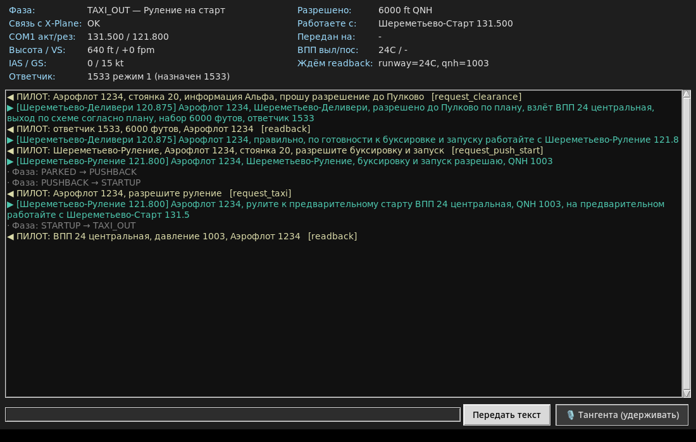
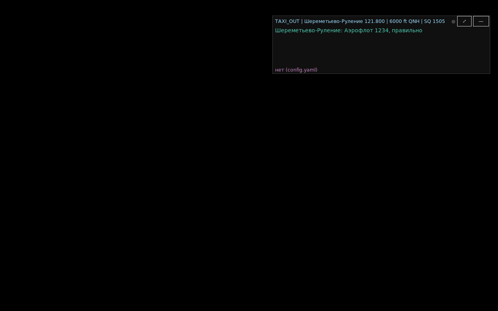

# RU ATC 0.3.0-beta

Русскоязычный голосовой диспетчер для X-Plane 12. Это внешняя программа для Windows: она следит за полётом Zibo 737, слушает эфир через микрофон и отвечает голосом органов ОВД. Распознавание и синтез работают офлайн (Vosk и Silero).

Учебный симуляторный проект. Частоты и схемы берутся из установки X-Plane 12, если она найдена. Файлы `data/` — запас и русские позывные, не данные для настоящей навигации.

Портрет в полном окне зависит от пола голоса: [женский](ru_atc/assets/atc_female.png), [мужской](ru_atc/assets/atc_male.png). Образец голоса — [docs/atc_sample.wav](docs/atc_sample.wav).

## Что умеет

* Разрешения, передачи и учебные проверки по фазам полёта: от Деливери до руления после посадки, включая Москва-Контроль и Санкт-Петербург Контроль. Частоты и сектор РЦ — из данных X-Plane, если кэш собрался.
* [Навигационные данные](docs/wiki/Навигационные-данные.md): кэш, файлы симулятора, папка X-Plane, страница установщика.
* План из FMC Zibo и из файла `.fms`.
* Окно поверх симулятора, компактная панель с последними пятью репликами, горячие клавиши.
* Мягкий readback: «подтверждаю» и «понял» закрывают указание, неверная ВПП, эшелон, код или частота — нет.
* Портрет диспетчера по голосу органа.

## Документация

Установка, модели, настройка и первый вылет — в вики. Те же страницы лежат в репозитории: [docs/wiki](docs/wiki/Home.md).

* [Требования](docs/wiki/Требования.md)
* [Установка](docs/wiki/Установка.md)
* [Модели речи](docs/wiki/Модели-речи.md)
* [Настройка](docs/wiki/Настройка.md)
* [План полёта](docs/wiki/План-полёта.md)
* [Первый полёт](docs/wiki/Первый-полёт.md)
* [Устранение неполадок](docs/wiki/Устранение-неполадок.md)
* [Сборка установщика](docs/wiki/Сборка-установщика.md)

Опубликованная вики: <https://github.com/UncleUSN/xplane-ru-atc/wiki>

## Ещё файлы

* [Журнал изменений](CHANGELOG.md) — выпуск 0.3.0-beta и схема `R.X.Y-beta`.
* [Как меняется версия](CONTRIBUTING.md).
* Лицензия проекта пока не выбрана, файла `LICENSE` нет.
* [Лицензии библиотек и моделей](THIRD_PARTY_LICENSES.md).
