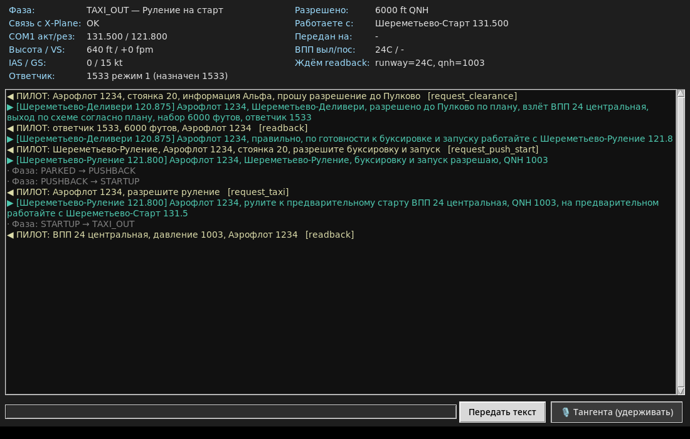
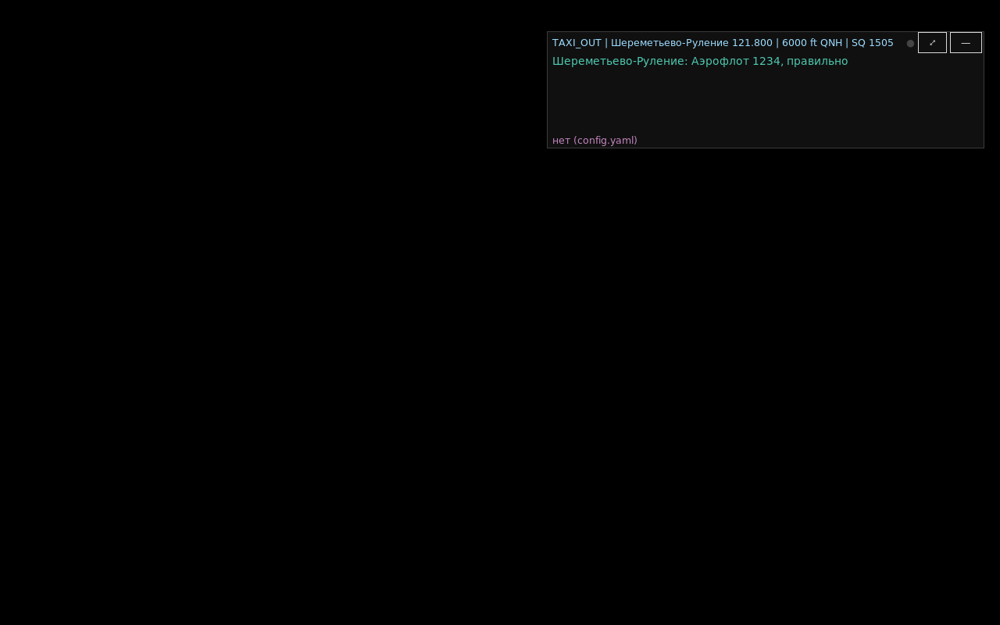

# RU ATC 0.3.1-beta

Русскоязычный голосовой диспетчер для X-Plane 12. Программа стоит рядом с симулятором, а не внутри него: окно tkinter, микрофон, распознавание Vosk и голос Silero. Считается полёт Zibo 737, диспетчер выдаёт разрешения и передачи на русском.

Это публичная бета. Частоты и схемы по возможности берутся из вашей установки X-Plane 12. Учебные файлы `data/` остаются запасом и русскими позывными.

Портреты:  

## С чего начать

1. [[Требования]] — X-Plane 12, Web API, Zibo, гарнитура.
2. [[Установка]] — мастер Windows, без отдельной установки Python.
3. [[Модели речи]] — какая кнопка что значит и откуда качается файл.
4. [[Настройка]] — `config.yaml`: строгость readback, приветствия, окно, горячие клавиши, папка X-Plane.
5. [[Первый полёт]] — Шереметьево → Пулково. Фразы по фазам: [[Радиообмен]].
6. [[Устранение неполадок]] — папка FMS, прокси, микрофон.

План из FMC разобран отдельно: [[План полёта]]. Откуда частоты и кэш: [[Навигационные данные]]. Что в файлах `data/` осталось учебным: [[Данные]].

Исходники и сборка установщика: [[Запуск из исходников]], [[Сборка установщика]].

Журнал версии 0.3.1-beta и схема `R.X.Y-beta` — в репозитории, файл `CHANGELOG.md`. Лицензии библиотек и моделей — `THIRD_PARTY_LICENSES.md`. Лицензия самой программы ещё не выбрана.
